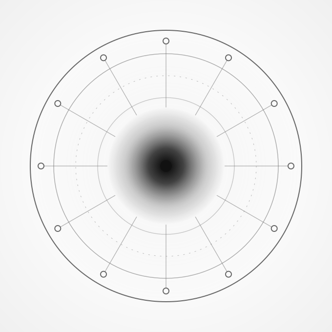

<!--
SPDX-FileCopyrightText: 2026 The IndustryFlow contributors
SPDX-License-Identifier: CC-BY-SA-4.0
-->

# IndustryFlow

**Open-core, general-purpose industrial-IoT data platform: device ingestion, stream processing, per-tenant isolation, anomaly detection, alerting and embedded notebooks.**

<picture>
  <source media="(prefers-color-scheme: dark)" srcset="img/industryflow-logo-mono-dark.svg" />
  
</picture>

## Capabilities

| Capability | Implementation | Decision |
|---|---|---|
| Device ingestion | mTLS edge; tenant taken from the device certificate | ADR-0002, ADR-0007 |
| Stream processing | Kafka → Spark → TimescaleDB, at-least-once with idempotent writes | ADR-0005, ADR-0006 |
| Multi-tenancy | Schema-per-tenant; tenants provisioned at runtime | ADR-0003, ADR-0033 |
| Schema migrations | One ordered, idempotent script sequence applied by a runner and recorded in a ledger, fresh and live alike | ADR-0034 |
| Anomaly detection | Feature transforms and detectors over MLflow-registered models; a reading missing an input is refused, never scored on a substitute; a superuser's kill switch for stateful features, every flip recorded | ADR-0023, ADR-0028, ADR-0024, ADR-0043, ADR-0044 |
| Model lifecycle | Notebook versions promoted, or external models uploaded, through one registration gate; no author code on the serving side; drift baseline from a supplied sample, scores derived at deployment | ADR-0027, ADR-0035, ADR-0037, ADR-0040 |
| Alerting | Threshold, ML and statistical (model-drift) rules; operator labels | ADR-0021, ADR-0022, ADR-0031 |
| Authentication | HTTPS edge, httpOnly-cookie + CSRF platform sessions, bearer tokens for API clients; a session's tokens refused once it ends; password guessing slowed per account and source; a first-run superuser held to a password change | ADR-0004 |
| Embedded notebooks | Per-user notebook hub with capability handles, SQL proxy, tracking gateway; every capability's use recorded; experiments browsed in the console | ADR-0011, ADR-0015, ADR-0042 |
| Cold layer | Parquet history in object storage | ADR-0025 |
| Extensions | Domain feature transforms and detectors as plugins | ADR-0008, ADR-0010 |
| Deployment | Docker Compose (single host), Helm chart (Kubernetes) | ADR-0009 |
| Observability | Prometheus, Grafana, Loki; platform alert rules shared by Compose and the chart, routed by Alertmanager | ADR-0016 |
| Operator agents | Agents as services: a graph behind a trigger-in, note-out contract, tools over MCP, the model over an API; the infrastructure agent explains platform alerts on the operator's dashboards | ADR-0045, ADR-0046 |

The decision records, their manuals and the glossary are held outside this repository (ADR-0000).

## Technology

| Layer | Components |
|---|---|
| Services | Python 3.14, FastAPI |
| Streaming | Apache Kafka, Apache Spark 4.1 |
| Storage | PostgreSQL 15 + TimescaleDB, Redis, MinIO |
| ML | MLflow |
| Frontend | React 19, Vite, nginx |
| Observability | Prometheus, Alertmanager, Grafana, Loki |
| Agents | LangGraph, MCP; the model over the Claude API or an OpenAI-compatible endpoint |

## Documentation

| Page | Covers |
|---|---|
| [docs/README.md](docs/README.md) | Index of the pages in this repository |

## Contributing

| Step | Rule |
|---|---|
| Branch | From `main` |
| Python style | `ruff` (`ruff.toml`), gated in CI (ADR-0026) |
| Architecture | Code cites the decision it follows as `ADR-NNNN` or `ADR-NNNN dec N`; a change to a decision or its manual is proposed to the maintainer, never made in this repository (ADR-0000) |
| Change | Tests, and the pages of this repository it affects, in the same pull request |
| Release | A `v*` tag on a box-validated commit of `main` (ADR-0026 dec 8-10) |

## License

[AGPL-3.0-or-later](LICENSE) © 2026 The IndustryFlow contributors
