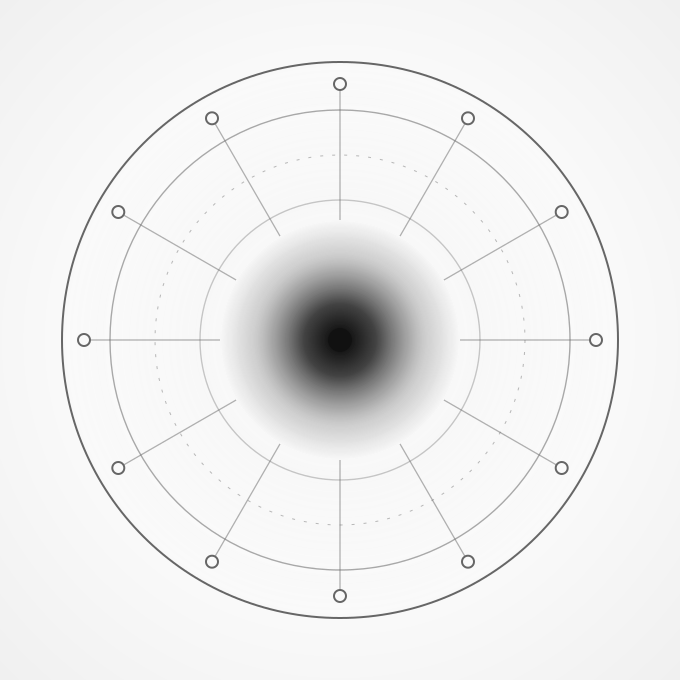

<!--
SPDX-FileCopyrightText: 2026 The IndustryFlow contributors

SPDX-License-Identifier: CC-BY-SA-4.0
-->

# IndustryFlow

**Open-core, general-purpose industrial-IoT data platform: device ingestion, stream processing, per-tenant isolation, anomaly detection, alerting and embedded notebooks.**

[](https://github.com/IIchukissII/industryflow/actions/workflows/unit-tests.yml)
[](https://github.com/IIchukissII/industryflow/actions/workflows/db-tenant-isolation.yml)
[](https://github.com/IIchukissII/industryflow/actions/workflows/helm.yml)
[](LICENSE)


<picture>
  <source media="(prefers-color-scheme: dark)" srcset="img/industryflow-logo-mono-dark.svg" />
  
</picture>

## Capabilities

| Capability | Implementation | Decision |
|------------|----------------|----------|
| Device ingestion | Mutual TLS edge, tenant taken from the device certificate | [ADR-0002](ADR/ADR-0002-ingestion-authentication-and-device-identity.md), [ADR-0007](ADR/ADR-0007-public-key-infrastructure.md) |
| Stream processing | Kafka → Spark → TimescaleDB, at-least-once with idempotent writes | [ADR-0005](ADR/ADR-0005-kafka-delivery-semantics.md), [ADR-0006](ADR/ADR-0006-spark-windowing-and-idempotent-writes.md) |
| Multi-tenancy | Schema-per-tenant; tenants provisioned at runtime | [ADR-0003](ADR/ADR-0003-tenant-to-schema-resolution.md), [ADR-0033](ADR/ADR-0033-tenant-lifecycle.md) |
| Anomaly detection | Feature transforms and detectors over MLflow-registered models | [ADR-0023](ADR/ADR-0023-stream-materialized-feature-engineering.md), [ADR-0028](ADR/ADR-0028-model-adapter-contract-and-score-semantics.md) |
| Alerting | Threshold, ML and statistical (model-drift) rules; operator labels | [ADR-0021](ADR/ADR-0021-model-drift-monitoring.md), [ADR-0022](ADR/ADR-0022-concept-drift-operator-feedback.md), [ADR-0031](ADR/ADR-0031-alerting-http-surface-single-owner.md) |
| Authentication | HTTPS edge, httpOnly-cookie + CSRF browser sessions, bearer tokens for API clients | [ADR-0004](ADR/ADR-0004-api-authentication-sessions-and-transport.md) |
| Embedded notebooks | Per-user JupyterHub with capability handles, SQL access proxy, tracking gateway | [ADR-0011](ADR/ADR-0011-embedded-notebooks-for-analytics-and-experimentation.md), [ADR-0015](ADR/ADR-0015-notebook-capability-minting-and-sql-proxy.md) |
| Cold layer | Parquet history in object storage | [ADR-0025](ADR/ADR-0025-cold-layer-historical-data-open-columnar.md) |
| Extensions | Domain feature transforms and detectors as plugins | [ADR-0008](ADR/ADR-0008-extension-and-plugin-interface.md), [ADR-0010](ADR/ADR-0010-extension-plugin-mechanism.md) |
| Deployment | `docker compose` (local), Helm chart (Kubernetes) | [ADR-0009](ADR/ADR-0009-kubernetes-deployment-and-packaging.md) |
| Observability | Prometheus, Grafana, Loki | [ADR-0016](ADR/ADR-0016-observability-and-monitoring-integration.md) |

## Quick start

```bash
git clone https://github.com/IIchukissII/industryflow
cd industryflow
cp .env.example .env               # replace every changeme_* value
scripts/device-ca.sh init          # device CA; the ingestion edge needs it to start
docker compose up -d
curl http://localhost:8000/health
scripts/create-tenant.sh "Your Company"   # prints the company_id
```

Seeding the first admin, endpoints and API examples: [docs/getting-started.md](docs/getting-started.md).

## Documentation

| Area | Link |
|------|------|
| Index of all docs | [docs/README.md](docs/README.md) |
| Getting started | [docs/getting-started.md](docs/getting-started.md) |
| Architecture | [docs/architecture/README.md](docs/architecture/README.md) |
| API | [docs/api/README.md](docs/api/README.md); Swagger UI at `http://localhost:8000/docs` |
| Helm chart | [deploy/helm/industryflow/](deploy/helm/industryflow/README.md) |
| Decisions | [ADR/](ADR/) and [ADR/GLOSSARY.md](ADR/GLOSSARY.md) |

## Technology

| Layer | Components |
|-------|------------|
| Services | Python 3.14, FastAPI |
| Streaming | Apache Kafka, Apache Spark 4.1 |
| Storage | PostgreSQL 15 + TimescaleDB, Redis, MinIO |
| ML | MLflow |
| Frontend | React 19, Vite, nginx |
| Observability | Prometheus, Grafana, Loki |

## Contributing

1. Branch from `main`.
2. Python style: `ruff`, configured in `ruff.toml`, gated in CI ([docs/operations/ci.md](docs/operations/ci.md)).
3. Architectural decisions are recorded as ADRs ([ADR-0000](ADR/ADR-0000-decision-records-and-source-of-truth.md)).
4. Add tests and update the affected docs.
5. Open a pull request.

## License

[AGPL-3.0-or-later](LICENSE) © 2026 The IndustryFlow contributors
